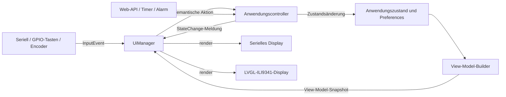

# Architektur

Dieses Dokument beschreibt den aktuellen Code einschließlich der noch übergangsweisen Kopplungen. Ziel ist, verschiedene Boards und I/O-Geräte zu unterstützen, ohne zeichnungs- oder pinabhängige Logik in die Anwendungsaktionen zu legen.

English version: [ARCHITECTURE.md](ARCHITECTURE.md).

## Struktur

```text
src/
  main.cpp                  Start, Arduino-Hauptschleife und Koordination
  app/                      Controller, Alarmplanung, gemeinsamer Zustand, Board-Setup-Vertrag
  audio/                    Stream-Decoder, I2S-Ausgabe und Weckton
  net/                      WLAN, HTTP-API, Wetter und OTA
  ui/                       View-Model, Ein-/Ausgabe-Verträge und UI-Manager
  drivers/
    display/<treiber>/      Serielle und LVGL/ILI9341-Ausgabe
    input/<treiber>/        Serielle Eingabe, GPIO-Tasten und Drehencoder
    outputs.h               Verträge für Backlight und Raumlicht; Treiber fehlen noch
hardware/<board>/           Pins, board-spezifische Treiberregistrierung und Hardware-Dokumentation
test/                       Host-Tests für plattformunabhängige Algorithmen
```

PlatformIO-Umgebungen wählen Board, Quellfilter, Bibliotheken und Verdrahtung aus. `hardware/<board>/board_setup.cpp` registriert Treiber mit statischer Lebensdauer beim gemeinsamen `UiManager`. Pin-Definitionen liegen im jeweiligen Board-Ordner.

Verträge sollten beim jeweiligen Verbraucher liegen statt in einem allgemeinen Hardware-Ordner: `IDisplay` und `IInput` bleiben bei der UI, ein Raumlicht-Port gehört zur Anwendungs-/Alarmsteuerung und ein Audioquellen-Vertrag zum Player; SD ist eine konkrete Quellenimplementierung. `IBacklight` und `ILightOutput` liegen aktuell nur als ungenutzte Platzhalter gemeinsam in `src/drivers/outputs.h`; beim Hinzufügen der ersten Treiber sollten sie getrennt werden.

## Daten- und Kontrollfluss



`main.cpp` initialisiert die Board-Treiber und bedient anschließend Audio, Webserver, UI/Eingabe, Wetter und zeitgesteuerte Alarmfunktionen. Controller-Listener markieren die UI als geändert. Solange die normale UI aktiv ist, rendert der Manager nach Zustandsänderungen und mindestens einmal pro Sekunde für die Uhr. WLAN- und OTA-Statusseiten halten das normale Rendering an, bis die Anwendung `showHome()` aufruft.

## I/O-Verträge

### Display: `IDisplay`

Ein Ausgabegerät initialisiert sich, meldet grundlegende Fähigkeiten, rendert ein `const ViewModel&` und kann einen vorübergehenden `StatusScreen` anzeigen. Das `ViewModel` ist ein Snapshot mit festen Puffern. Displaytreiber sollen ihn darstellen, nicht den Anwendungszustand speichern oder die Wiedergabe steuern. Mehrere Displays können denselben Snapshot erhalten.

Das serielle Display gibt nur geänderte Statuszeilen aus. Mit `i` wird nach dem Öffnen des Monitors erneut ausgegeben. Der LVGL-Treiber kapselt die ursprünglichen TFT-Seiten.

### Eingabe: `IInput`

Ein Eingabegerät wird nicht-blockierend abgefragt und meldet semantische `InputEvent`-Werte statt GPIO-Pegel oder Tastencodes. Der Manager übersetzt die Ereignisse in Controller-Aktionen. Serielle Eingabe, Tasten und Encoder verwenden somit dieselbe Aktionsstrecke.

`Snooze` bedeutet Schlummern bei aktivem Alarm, sonst den Einschlaftimer starten. `VolumeDelta` ist eine vorzeichenbehaftete Änderung in Prozentpunkten; `VolumeSet` enthält einen absoluten Wert von 0 bis 100. Abfrage und Ereignisverarbeitung laufen in der Hauptschleife, nicht in einem Anwendungs-Worker-Task.

### Controller: `app/controller.*`

Der Controller ist der gemeinsame Aktionspfad für UI, Webanfragen und Hardwareeingabe. Er ändert Einstellungen, speichert sie in NVS, steuert Wiedergabe und Sender und benachrichtigt Listener. Listener werden synchron aufgerufen und müssen kurz bleiben; der UI-Listener markiert lediglich die Anzeige als geändert.

Diese Grenze ist noch keine vollständig plattformunabhängige Domänenschicht: Controller-Funktionen verwenden weiterhin Arduino-Dienste, Preferences und gemeinsamen globalen Zustand. Explizite `Settings`- und `AppState`-Typen sind noch ein Roadmap-Punkt.

### Weitere Ausgänge

`IBacklight` beschreibt eine Display-Hintergrundbeleuchtung mit fester oder automatischer Helligkeit. `ILightOutput` beschreibt ein unabhängig dimmbares Raumlicht. Die geplante Sonnenaufgangsrampe gehört zur Alarmsteuerung; der Treiber soll lediglich den Ausgabewert setzen. Beide Verträge existieren, sind aber noch nicht beim `UiManager` registriert und nicht in den Alarmablauf eingebunden.

Audio ist aktuell eine einzelne Stream-/Decoder-/I2S-Pipeline in `src/audio/`. Eine `IAudioSource`-Abstraktion für Stream, SD-Datei und erzeugten Weckton gibt es noch nicht. Diese Unterscheidung sollte bei SD-Klingeltönen klar eingeführt werden.

## Aktuelle Grenzen

- `ViewModelBuilder` kopiert den gemeinsamen Zustand in einen Snapshot, der LVGL-Treiber liest und verändert jedoch weiterhin direkt alte globale Variablen. Er ist in `IDisplay` gekapselt, aber noch nicht vollständig View-Model-basiert.
- Einstellungen, Zeitwerte und Wiedergabezustand liegen teilweise weiterhin als globale Variablen in `app_state.*`. Der Controller bündelt Aktionen, besitzt aber noch nicht den gesamten Zustand.
- YB Rev.3 wurde auf echter Hardware mit serieller Konsole, WLAN und I2S-Wiedergabe getestet. GPIO-Eingaben kompilieren und ihre Dekodier-/Entprelllogik besteht native Tests, wurden aber nicht mit physischen Tasten oder Encoder geprüft.
- Die Umgebung `esp32_ili9341` wurde nur kompiliert.
- Die Web-Seite liegt noch als großer eingebetteter Header vor. Quelldateien und Build-Embedding sind geplant.

## Einen Treiber hinzufügen

1. `IDisplay` oder `IInput` unter `src/drivers/<art>/<treiber>/` implementieren; Pins und Konstruktion in `hardware/<board>/board_setup.cpp` belassen.
2. Displays verwenden nur das `ViewModel` und Status-Aufrufe. Wiedergabe nicht aus dem Rendering starten und keine Preferences ändern.
3. `poll()` schnell und nicht-blockierend halten und semantische Ereignisse liefern. Interrupts sollen Hardwareflanken erfassen; Ereignisse werden in der Hauptschleife verarbeitet.
4. Eine kurze README neben dem Treiber ergänzen und reine Dekodier-/Zustandslogik nach Möglichkeit unter `test/` testen.
