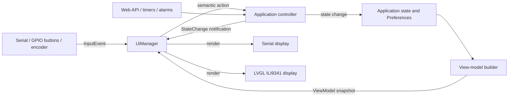

# Architecture

Deutsch: [ARCHITECTURE.de.md](ARCHITECTURE.de.md).

This document describes the code as it exists now, including the boundaries that are still transitional. The goal is to support different boards and I/O devices without putting hardware-specific drawing or pin logic in application actions.

## Structure

```text
src/
  main.cpp                  Startup, main loop and coordination of network/audio/alarm work
  app/                      Application actions, alarm scheduling, shared state and board setup contract
  audio/                    Stream decoding, I2S output and alarm beep
  net/                      Wi-Fi, HTTP API, weather and OTA
  ui/                       View-model, input/output contracts and UI manager
  drivers/
    display/<driver>/       Serial and LVGL/ILI9341 output implementations
    input/<driver>/         Serial, GPIO-button and rotary-encoder input implementations
    outputs.h               Backlight and room-light contracts; implementations are pending
hardware/<board>/           Pins, board-specific device registration and wiring documentation
web content                 Currently embedded in src/net/web_pages.h; extraction is planned
test/                       Host-side tests for platform-independent algorithms
```

PlatformIO environments select a board, source filter, libraries and board wiring. `hardware/<board>/board_setup.cpp` registers static-lifetime devices with the shared `UiManager`. Board pin definitions are kept in the same board folder.

Keep interfaces near their consumer rather than in a generic hardware bucket: `IDisplay` and `IInput` stay with UI, a room-light port belongs with application/alarm policy, and an audio-source contract belongs with the player while SD is one source implementation. `IBacklight` and `ILightOutput` are currently grouped in `src/drivers/outputs.h` only as unused placeholders; split them when their first implementations are added.

## Data And Control Flow



`main.cpp` initializes the board devices, then services audio, the web server, UI/input, weather and timed alarm work. Controller listeners mark the UI dirty. While the normal UI is active, the manager renders when state changes and at least once per second so a clock can advance. Full-screen connection and OTA status screens hold normal rendering until the application calls `showHome()`.

## I/O Contracts

### Display: `IDisplay`

An output device initializes itself, advertises basic capabilities, renders a `const ViewModel&`, and can show a transient `StatusScreen`. `ViewModel` is a fixed-size snapshot: display drivers should format and draw it, not persist application state or control playback. Multiple displays may be registered and receive the same snapshot.

The serial display prints changed status lines and is intentionally sparse. Use `i` in the serial input to request a redraw after opening the monitor. The LVGL driver wraps the original TFT screens.

### Input: `IInput`

An input device is polled without blocking and reports semantic `InputEvent` values, not GPIO levels or key codes. The manager translates those events into controller actions. Serial, button and encoder hardware can therefore issue the same actions.

`Snooze` means snooze when an alarm is active and start the sleep timer otherwise. `VolumeDelta` is a signed percentage-point change; `VolumeSet` carries an absolute 0-100 value. Device polling and event handling run from the main loop, not an application worker task.

### Controller: `app/controller.*`

The controller is the shared action path for UI, web requests and hardware input. It applies settings, persists them to NVS, starts/stops playback, changes stations and notifies listeners. Listener callbacks run synchronously and should stay short; the UI listener only marks the view dirty.

This boundary is not yet a fully platform-independent domain layer: controller functions still use Arduino services, Preferences and shared global state. Moving that state into explicit `Settings`/`AppState` types is a roadmap item.

### Other Outputs

`IBacklight` represents a display backlight with optional automatic brightness. `ILightOutput` represents an independently dimmable room light; the intended sunrise ramp belongs to application alarm policy, while the implementation only sets output level. These contracts are defined but are not yet registered with `UiManager` or used by the alarm flow.

Audio is currently a single stream/decoder/I2S pipeline in `src/audio/`. There is not yet an `IAudioSource` abstraction for stream versus SD file versus generated beep. Keep that distinction explicit when SD ringtones are added.

## Current Limitations

- `ViewModelBuilder` copies shared state into a snapshot, but the LVGL implementation still reads and mutates legacy globals directly. It is wrapped as an `IDisplay`, but is not yet fully view-model-only.
- Several settings, time values and playback flags remain globals in `app_state.*`; the controller centralizes actions but does not yet own all state.
- The YB Rev.3 serial console and I2S playback have been verified on hardware. GPIO inputs compile and their decoding/debounce logic passes native tests, but no physical buttons or encoder are configured or tested.
- The `esp32_ili9341` environment is compile-checked only.
- The web page remains a large embedded header. Moving it to editable source assets and embedding it during the build is planned.

## Adding A Driver

1. Implement `IDisplay` or `IInput` under `src/drivers/<kind>/<driver>/`; keep pins and construction in the relevant `hardware/<board>/board_setup.cpp`.
2. For displays, consume only the `ViewModel` and transient status calls. Do not start playback or write preferences from rendering code.
3. For inputs, return quickly from `poll()` and emit semantic events. Keep interrupt handlers limited to capturing hardware edges; translate them to events from the main loop.
4. Add a short driver README beside the implementation and test pure decoding/state logic in `test/` where practical.
